# BorrowBuddy — frontend

The BorrowBuddy UI: a React 18 single-page app built with Vite and React Router.
It talks to the Spring Boot API in
[borrow-buddy-backend](https://github.com/Harshavardhan-15/borrow-buddy-backend).

BorrowBuddy is a campus borrow-and-lend platform. Students list items they own,
request items from other students, hand items over with a QR code, and review
each other afterwards.

## Live demo

<https://borrowbuddy-lyart.vercel.app>

The app is hosted on Vercel and talks to the Spring Boot API on Render at
`https://borrowbuddy-api-zeu2.onrender.com`. Sign in with a demo account
(password `Password123`): `aarav@college.edu`, `priya@college.edu`,
`rohan@college.edu` or `sara@college.edu`. The API sleeps after 15 minutes of
inactivity, so the first request can take 30–60 seconds.

## Screenshots

| Home | Browse items |
| --- | --- |
| 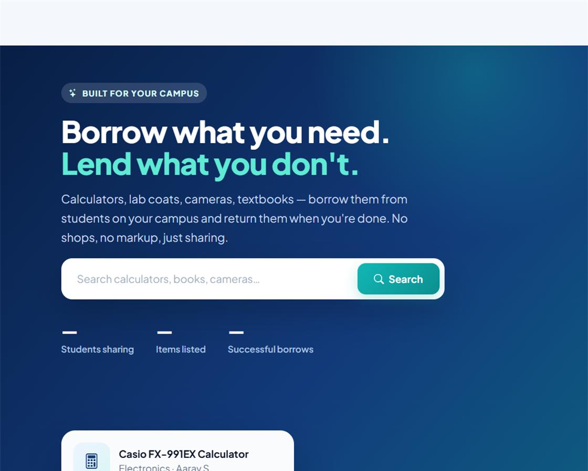 | 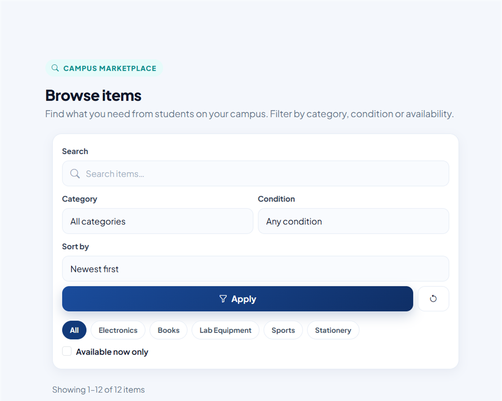 |

| Dashboard | Item details |
| --- | --- |
| 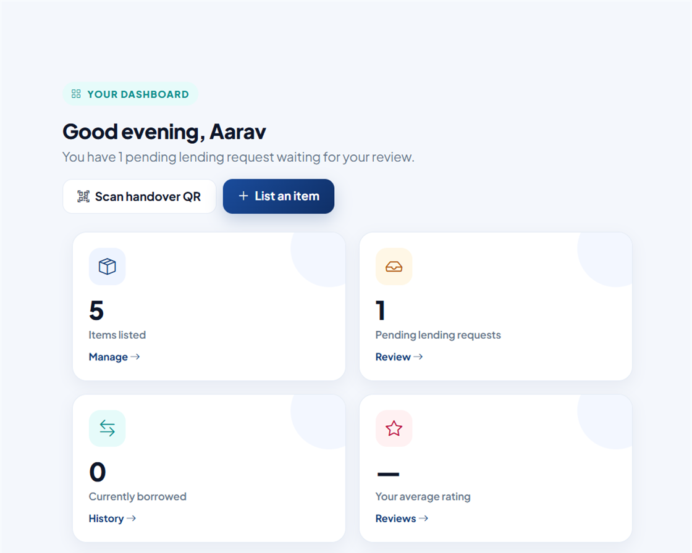 |  |

| Borrow requests | Profile |
| --- | --- |
| 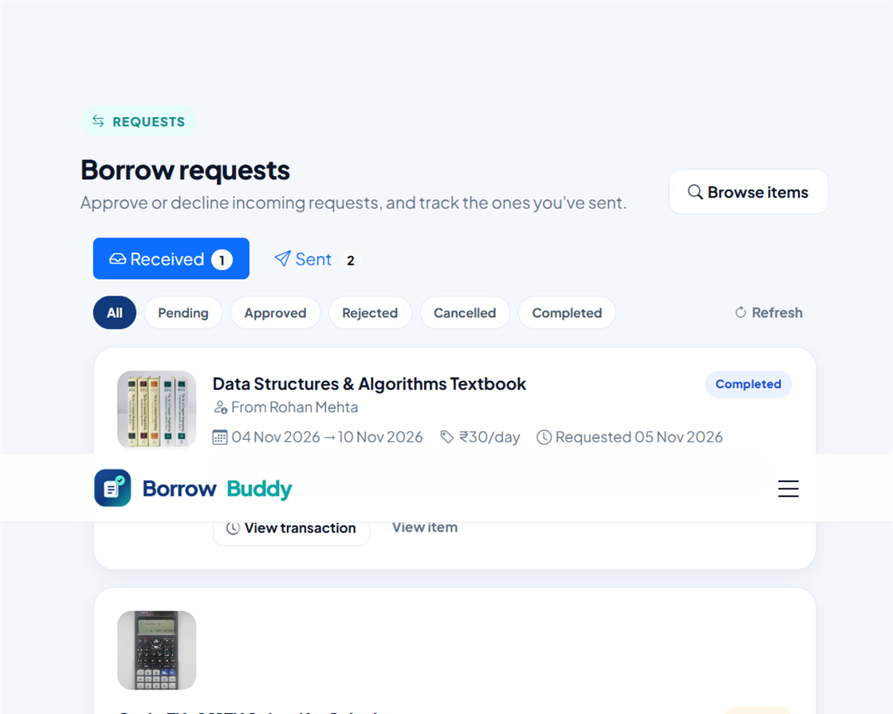 | 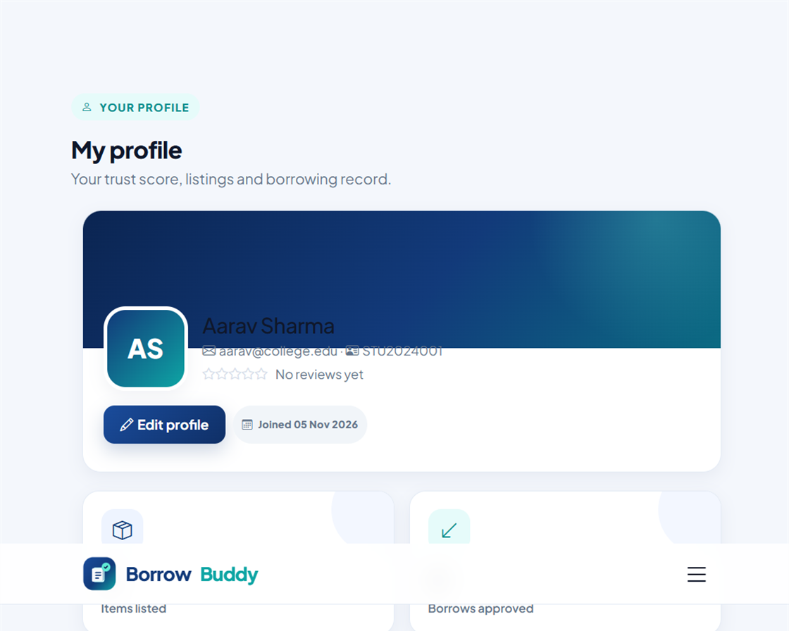 |

| Notifications | Ratings and reviews |
| --- | --- |
| 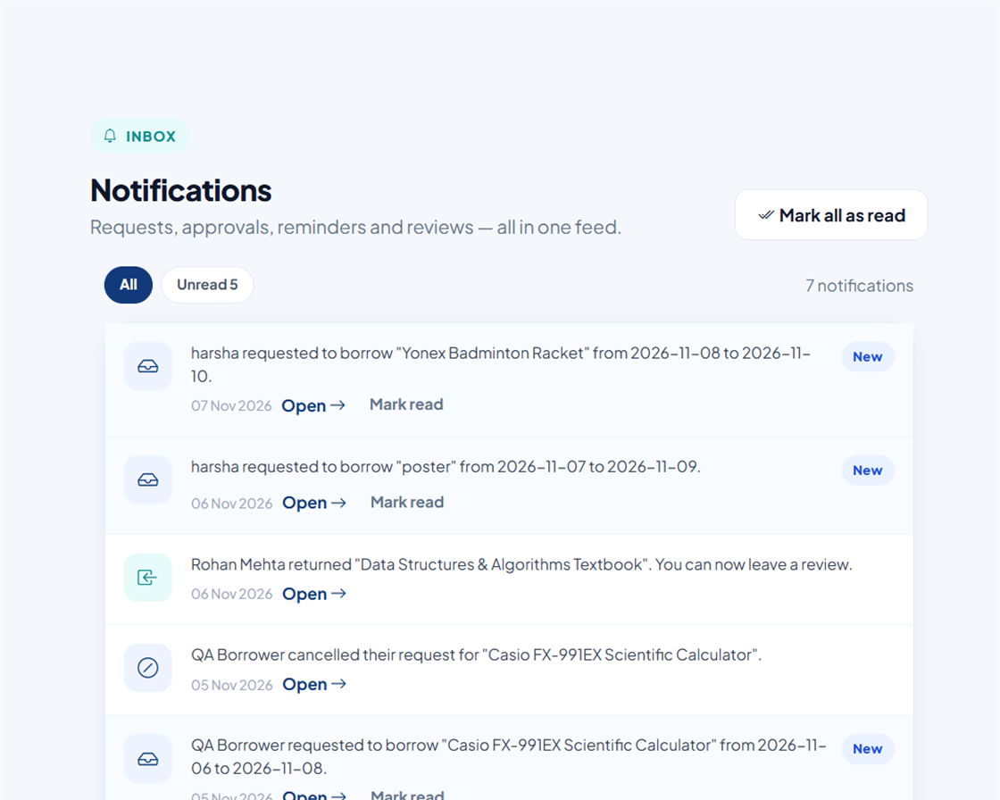 | 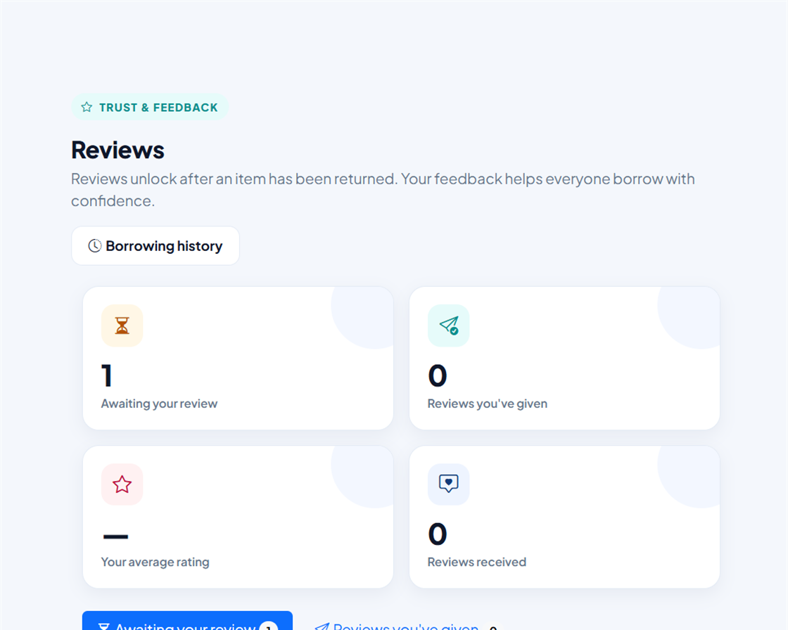 |

| Add / edit item | Borrowing history |
| --- | --- |
| 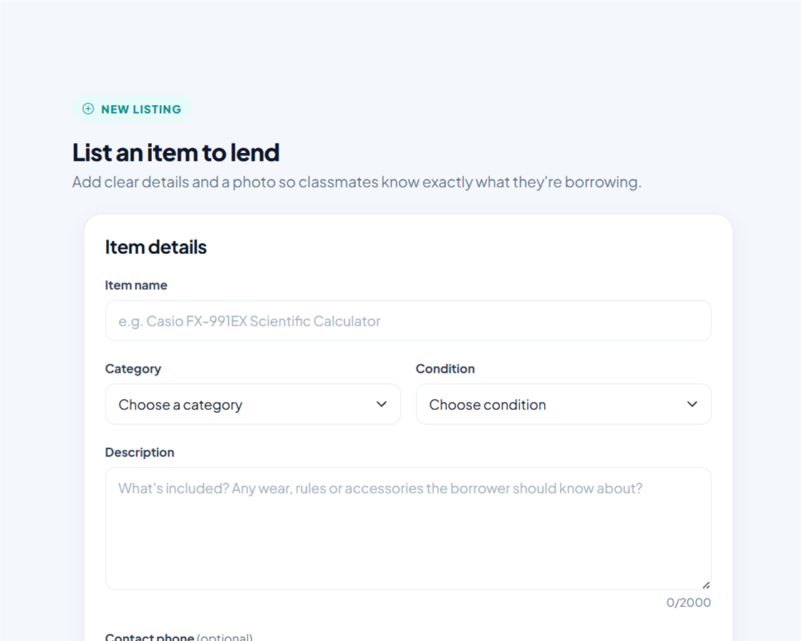 | 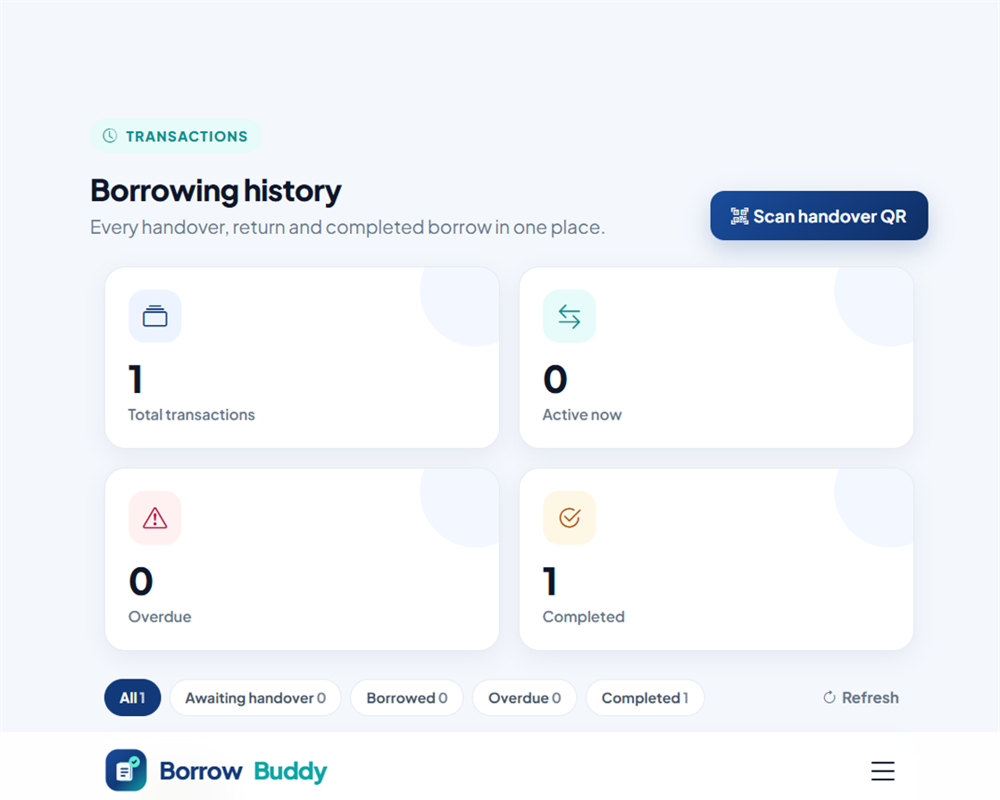 |

| Login | Registration |
| --- | --- |
| 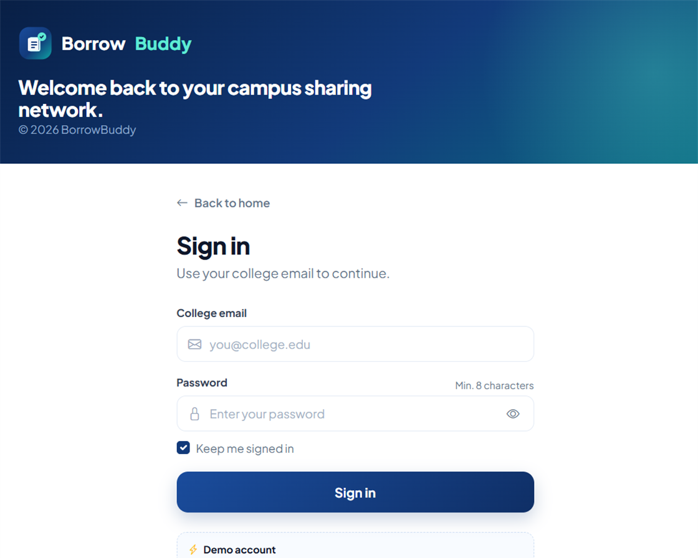 | 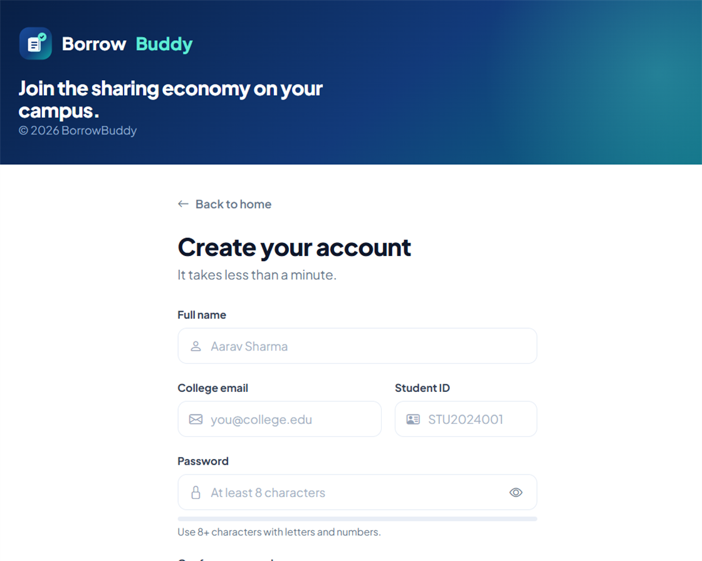 |

## Requirements

- Node.js 20+ and npm 10+
- The API running on `http://localhost:8080` for local development

## Development

```powershell
npm ci
npm run dev
```

Open `http://localhost:5173`. Vite proxies `/api` and `/uploads` to the backend,
so no extra configuration is needed.

## Production build

```powershell
npm run build
```

The bundle is written to `dist/`. Serve it from any static host; React Router
paths are rewritten to `index.html`.

## Deploying to Vercel

`vercel.json` is included. It installs dependencies, builds the app, publishes
`dist/`, rewrites unknown paths to `index.html`, and sets security and caching
headers.

This repository is already linked to the **borrowbuddy** Vercel project
(production branch `main`, live at <https://borrowbuddy-lyart.vercel.app>), so a
push to `main` redeploys it with the stored `VITE_API_BASE`. To set it up from
scratch:

1. **Add New → Project** and import this repository.
2. Keep the root directory at the repository root.
3. Add an environment variable `VITE_API_BASE` set to the deployed API origin,
   for example `https://borrowbuddy-api.onrender.com`.
4. Deploy.

Then add this site's origin to the backend's `FRONTEND_URL` CORS list and
redeploy the backend.

### Preview deployments

Vercel preview deployments use a different hostname on every push. The backend
allows only the exact origins in `FRONTEND_URL`, so add a preview domain there
temporarily if you need to test one.

## Configuration

| Variable | When | Notes |
| --- | --- | --- |
| `VITE_API_BASE` | Production | API origin, baked in at build time. Leave empty when the API serves the SPA from the same origin. |

Uploaded images are returned as `/uploads/<file>` and resolved against
`VITE_API_BASE`, so they load from the API host when the app is hosted
separately.

## Structure

```
src/
├── main.jsx          # React root + providers
├── App.jsx           # Route map and protected routes
├── styles.css        # Shared BorrowBuddy design system
├── api/client.js     # fetch wrapper, JWT store, ApiError
├── context/          # Auth, toast and shared UI providers
├── components/       # Navbar, cards, modals, stars, states
├── pages/            # 12 application pages
└── utils/format.js   # Dates, money, status labels, image fallbacks
```

## Windows note

Some Windows environments block Rollup's native `.node` binary with an
Application Control policy. `package.json` therefore aliases `rollup` to
`@rollup/wasm-node`, which produces the same bundle without the native module.
The alias is harmless on Linux, macOS and CI.
